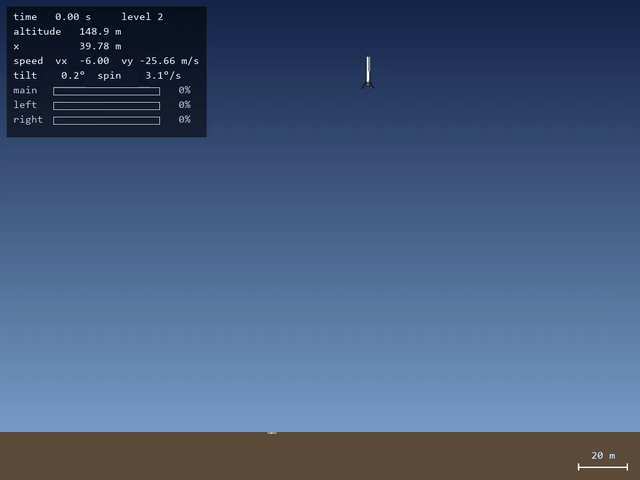
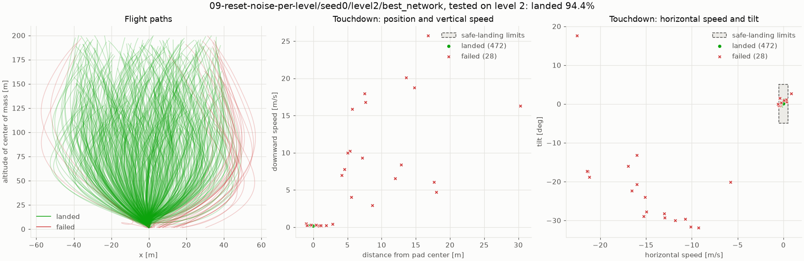
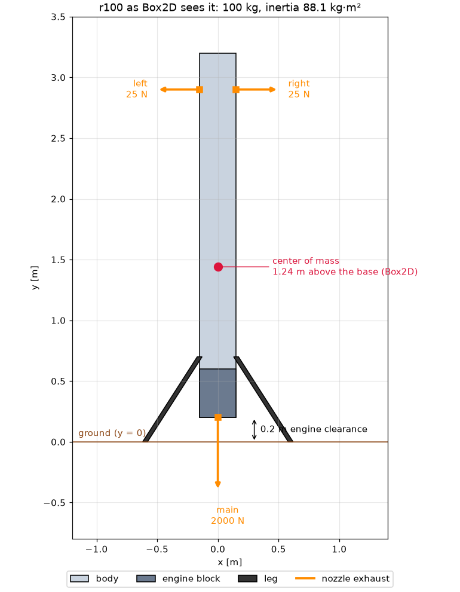
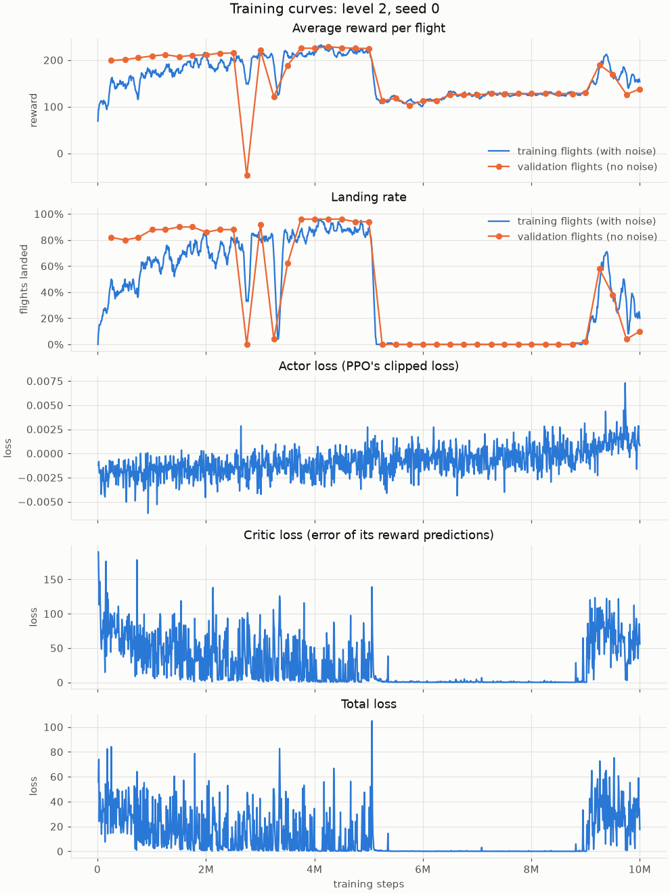

# Rocket Landing Controller with Deep Reinforcement Learning

<p align="center">
  
</p>
<p align="center"><em>The trained network on a level-2 test start it never saw in training: 149 m
up, 40 m to the side of the pad, and falling at 26 m/s. Shown in real time.</em></p>

A 2D rocket, simulated with Box2D, learns to land on a pad. A small neural network (two layers
of 64) is trained with PPO (Proximal Policy Optimization), then compared with a hand-written
PD (proportional-derivative) autopilot on the same 500 test starts per difficulty level.

**Result:** the network lands **100%, 100% and 94.4%** of the test starts at levels 0, 1 and 2
(the autopilot lands all of them), while landing faster and using less fuel.

**Try it in your browser:** [deep-rl-rocket-landing.web.app](https://deep-rl-rocket-landing.web.app/)
flies the trained network from this project, using its weights
([source code](https://github.com/mohamadalichamseddine/rocket-landing-web)).

Box2D does the physics, and Stable-Baselines3 (SB3) provides the PPO algorithm. The rocket
model, the landing environment, the reward, the network (PyTorch), the autopilot and the
evaluation are written for this project.

## Results

Each controller flies the same 500 fixed starts per level (the test set), never used in
training. Flight time and fuel are averages over the 500 flights; fuel is in seconds of full
main-engine thrust.

| Test set | Landed: network | Landed: PD autopilot | Flight time: network | Flight time: PD autopilot | Fuel: network | Fuel: PD autopilot |
|---|---|---|---|---|---|---|
| Level 0 | 100% | 100% | 15.2 s | 16.2 s | 8.0 s | 8.3 s |
| Level 1 | 100% | 100% | 16.2 s | 19.8 s | 8.8 s | 10.4 s |
| Level 2 | 94.4% | 100% | 16.2 s | 23.8 s | 9.2 s | 12.8 s |

<p align="center">
  
</p>
<p align="center"><em>The network on the level-2 test set: the flight paths (left), and each
touchdown compared with the safe-landing limits, the dashed boxes (middle and right).</em></p>

- **What made the difference:** resetting the exploration noise at the start of each level
  ([experiment 09](#experiments)). Without it, the level-2 network landed only 56.6% of the
  level-2 test set.
- **Where it still fails:** most level-2 failures start far from the pad and moving away from
  it. The network turns around too late and comes down too fast. Almost all of them are on the
  right side of the pad, which may be a habit of this one training run.
- **Compared with the PD autopilot:** the network lands faster and with less fuel, while the
  autopilot lands every start, with touchdowns closer to the pad center.

## The task

### The rocket

<p align="center"></p>

- 100 kg and 3 m tall: an 80 kg body and a 20 kg engine block, standing on two legs.
- A main engine of 2,000 N at the base (about twice the rocket's weight), and two side nozzles
  of 25 N near the top. The rocket moves sideways mostly by tilting, so that the main engine
  pushes partly sideways; the side nozzles turn it.
- Box2D calculates the center of mass (1.24 m above the base) and the moment of inertia
  (88 kg·m²) from the shapes, and simulates the flight: 50 control steps per second, each split
  into 5 physics steps. There is no wind or drag, and the mass stays constant.

### What the network sees and controls

- **Observation**, 8 numbers in physical units: the position of the center of mass (`x` from
  the pad center, and `y`), its velocity (`vx`, `vy`), the tilt as `sin` and `cos` (so there is
  no jump when the angle wraps around), the spin, and the mass.
- **Action**, 3 numbers from -1 to 1, one per nozzle (main, left, right), turned into throttles
  from 0% to 100%.

### How a flight ends

A touchdown is a **safe landing** only if all of these hold, judged just before contact, and
only the legs touch the ground:

| Distance from pad center | Horizontal speed | Vertical speed | Tilt | Spin |
|---|---|---|---|---|
| ≤ 0.5 m | ≤ 0.5 m/s | ≤ 0.3 m/s | ≤ 5° | ≤ 5°/s |

Any other touchdown is an **unsafe touchdown**. A flight also ends when the rocket tilts past
90° (**lost control**), goes more than 100 m to the side or above 300 m (**out of bounds**), or
reaches 60 s (**time limit**, which stands in for running out of fuel). The engines are cut at
touchdown.

### Difficulty levels

Each start is drawn at random within the ranges of its level:

| Level | Altitude | Distance from pad | Horizontal speed | Falling speed | Tilt | Spin |
|---|---|---|---|---|---|---|
| 0 | 50–80 m | ±5 m | ±1 m/s | 5–10 m/s | ±3° | 0 |
| 1 | 50–150 m | ±20 m | ±5 m/s | 5–20 m/s | ±10° | ±5°/s |
| 2 | 100–200 m | ±40 m | ±10 m/s | 10–30 m/s | ±15° | ±10°/s |

## Reward

Every step, the rocket earns how much its **landing score** improved, minus the fuel and the
time it used:

$$r_t = \big(S(s_{t+1}) - S(s_t)\big) - 2.0 \cdot \text{fuel}_t - 1.0 \cdot \Delta t$$

$$S(s) = -\big(1.0 \cdot \text{distance} + 1.0 \cdot \text{speed} + 10 \cdot |\text{tilt}|\big)$$

where the distance is to where the center of mass is when standing on the pad. When the flight
ends, a bonus or a penalty is added.

| Term | Value | When |
|---|---|---|
| Getting closer to the landing point | 1.0 per m | every step |
| Slowing down | 1.0 per m/s | every step |
| Getting upright | 10 per radian (about 0.17 per degree) | every step |
| Fuel | -2.0 per second of full main-engine thrust (side nozzles count by their thrust) | every step |
| Time in the air | -1.0 per second | every step |
| Safe landing | +100 | at the end |
| Unsafe touchdown | -10, and -2 per limit's worth of miss, summed over the failed checks (0.4 m/s with a 0.3 m/s limit is 0.33); never worse than -100 | at the end |
| Lost control, out of bounds, or the body hit the ground | -100 | at the end |
| Time limit | -100 | at the end |

Why it looks like this (the numbers refer to the [experiments](#experiments)):

- The progress terms pay for the **change** in the landing score, so hovering near the pad
  earns nothing.
- Fuel and time cost something at every step, so hovering costs something right away (03, 08).
  With a fuel cost of 0.3, hovering until the time limit scored about as well as touching down.
- An unsafe touchdown costs little when it is close to the limits, so that touching down a bit
  too fast still beats hovering until the time limit (02, 04). At -10 per limit, any touchdown
  faster than about 0.6 m/s scored worse than hovering.
- The time limit costs as much as a crash: it stands in for running out of fuel (02).

## Network and training

### Network

```
                        ┌─► actor:  8 → 64 → 64 → 3 throttles (+ a learned exploration noise)
8 scaled observations ──┤
                        └─► critic: 8 → 64 → 64 → 1 value: how much reward is still to come
```

- Two separate networks with tanh activations, 9,735 parameters in total. The actor decides
  the throttles. The critic estimates how much reward is still to come, which PPO uses during
  training to tell better-than-expected actions from worse ones. After training, only the actor
  flies the rocket.
- Written in PyTorch (`src/rocketlander/ppo/rocket_network.py`) and plugged into SB3's PPO,
  which adds the output layers.
- Each observation is divided by a fixed typical size (10 m, 50 m, 5 m/s, 10 m/s, 1, 1,
  1 rad/s, 100 kg), so the inputs are about -1 to 1.

### Training

- **Levels in order:** level 0 starts from random weights; each higher level starts from the
  best network of the level below. The exploration noise goes back to its starting value at
  every level.
- **Experience:** 8 rockets fly at once, each in its own process, with exploration noise added
  to the network's actions. After every 8 × 1,024 = 8,192 steps, PPO updates the network: 10
  passes over those steps, in minibatches of 256.
- **Validation:** every 250,000 steps, the network flies 50 fixed validation starts without
  exploration noise. The best network (highest landing rate, then highest average reward) is
  kept.
- **Test:** at the end, 500 fixed starts per level, separate from the training and validation
  starts. Every controller flies the same ones.

The final network trained for 11M steps at level 0 and 10M steps each at levels 1 and 2, with
seed 0: about 3 hours on a laptop CPU, no GPU.

### Hyperparameters

From `configs/train/ppo.yaml`:

| Setting | Value | SB3 default | Notes |
|---|---|---|---|
| Learning rate | 1e-4 | 3e-4 | at 3e-4, training found landing, then lost it again |
| Discount factor (gamma) | 0.9995 | 0.99 | a flight lasts up to 3,000 steps; at 0.999, the time-limit penalty 60 s ahead counted 5%, at 0.9995 it counts 22% |
| GAE lambda | 0.98 | 0.95 | |
| Steps per rocket per update (`n_steps`) | 1,024 | 2,048 | × 8 rockets = 8,192 steps per update |
| Minibatch size | 256 | 64 | |
| Epochs per update | 10 | 10 | |
| Clip range | 0.2 | 0.2 | |
| Entropy bonus | 0 | 0 | |
| Starting exploration noise (`log_std_init`) | -1.0 (spread 0.37) | 0 (spread 1.0) | SB3's default was so noisy that training flights rarely landed gently; reset at every level |
| Hidden layers | 64, 64 (tanh), actor and critic separate | the same | |
| Rockets in parallel | 8 | | one per CPU core |

## Experiments

9 experiments, made of 12 training runs: about 90 million steps and 8 hours of training in
total. Each kept the settings of the one before and changed one part of the reward or of the
training. The landing rates are each experiment's best network on the test set of its level
(500 starts).

| # | Experiment | What changed | Landed: level 0 | Landed: level 1 | Landed: level 2 | What happened |
|---|---|---|---|---|---|---|
| 01 | first-reward | first reward: unsafe touchdown -50, and -10 per m/s of impact speed; no time-limit penalty | 95.0% | | | learned to land only after hovering for about 4M steps; slow (28 s per flight) |
| 02 | graded-touchdown-penalty | unsafe touchdown graded: -10, and -10 per limit's worth of miss; time limit -100 | 0% | | | hovered until the time limit: the far-off penalty looked cheaper than a near miss |
| 03 | time-cost | a time cost of 1.0 per second in the air | 0% | | | still hovered |
| 04 | cheaper-near-misses | -2 instead of -10 per limit's worth of miss | 100% | | | landed within 0.5M steps, then training collapsed into hovering |
| 05 | lower-learning-rate | learning rate 3e-4 → 1e-4 | 36.8% | | | the failures touched down just off center; training collapsed into hovering and was stopped at 3.25M steps |
| 06 | longer-horizon | gamma 0.999 → 0.9995 | 100% | | | landed every test start, but training collapsed into hovering again |
| 07 | less-exploration-noise | starting noise spread 1.0 → 0.37 | 71.2% | | | training collapsed into unsafe touchdowns |
| 08 | higher-fuel-cost | fuel cost 0.3 → 2.0; first run of levels 1 and 2 | 98.2% | 91.0% | 56.6% | training stayed steady at level 0; at level 2, the noise left from level 1 was too small to learn new moves |
| 09 | reset-noise-per-level | exploration noise reset at the start of each level | 98.2% | 98.6% | **94.4%** | the final network (08 and 09 share the level-0 run) |

What they showed:

- **Hovering is the main trap.** Touching down risks a penalty now, while the time-limit penalty
  is up to 60 s away and shrunk by the discount factor. The network first learned to land once a
  near miss cost less than hovering (04).
- **Training can suddenly collapse:** several runs found good landings, then lost them (04 to
  07, and the final level-2 run below). Keeping the best validation network, not the last one,
  saved the results. Training at level 0 stayed steady from experiment 08 on.
- **Each level needs fresh exploration noise.** A network that starts a harder level keeps the
  little noise it ended the level below with, too little to find new moves. Resetting it took
  level 2 from 56.6% to 94.4%.

<details>
<summary>Training curves of the final level-2 run</summary>

<p align="center">
  
</p>

The validation landing rate (orange) reached 96% after about 4M steps, then dropped to 0% at
5.25M steps, with every validation flight ending in an unsafe touchdown, and only partly
recovered. The best network, from 4.25M steps, is the one in the results.

</details>

## Run it yourself

Everything runs from the project folder with [uv](https://docs.astral.sh/uv/). No GPU is
needed.

### 1. Set up

```powershell
uv sync      # creates .venv/ with Python 3.13 and the exact versions pinned in uv.lock
```

### 2. Train

Train the levels in order: level 0 starts from random weights, and each higher level starts
from the best network of the level below. Replace `<experiment-name>` with a name of your
choice, such as `my-first-run`: it names the folder the outputs go to. These commands repeat the
training of the network from the results (experiment 09, seed 0): level 0 for 11M steps, in
three parts, then levels 1 and 2 for 10M steps each.

```powershell
uv run python scripts/ppo/train_ppo.py --experiment <experiment-name> --level 0
uv run python scripts/ppo/train_ppo.py --experiment <experiment-name> --level 0 --continue --steps 5000000
uv run python scripts/ppo/train_ppo.py --experiment <experiment-name> --level 0 --continue --steps 1000000
uv run python scripts/ppo/train_ppo.py --experiment <experiment-name> --level 1 --steps 10000000
uv run python scripts/ppo/train_ppo.py --experiment <experiment-name> --level 2 --steps 10000000
```

All of it took about 3 hours on a laptop. Training flies 8 rockets in parallel, one per CPU
core: keep the 8 to get the same results, as with fewer cores it only runs slower. The
networks, logs and training curves go to `runs/training/<experiment-name>/seed0/`.
[Training a network](docs/training.md) has the other options, how to follow progress, and how
to train on GitHub Codespaces.

### 3. Test

Fly the best level-2 network and the PD autopilot on the test sets (500 fixed starts per
level), then compare them:

```powershell
uv run python scripts/evaluation/evaluate_controller.py --network runs/training/<experiment-name>/seed0/level2/best_network.zip
uv run python scripts/evaluation/evaluate_controller.py              # the PD autopilot
uv run python scripts/evaluation/compare_controllers.py --level 2    # the two side by side
```

Each test saves its numbers and a plot like the one in [Results](#results) to `runs/test/`. To
test the network from the results without training, use
`--network networks/landing_network.zip`. The seed is fixed, but the numbers can still differ
slightly on other computers.

### Other commands

```powershell
# Watch the trained network land, from random level-2 starts
uv run python scripts/evaluation/watch_controller.py --network networks/landing_network.zip --level 2

# Re-fly the flight in the GIF: test episode 10 of level 2
uv run python scripts/evaluation/watch_controller.py --network networks/landing_network.zip --level 2 --test-episode 10

# Watch the PD autopilot land
uv run python scripts/evaluation/watch_controller.py --level 2

# Fly the rocket yourself: arrow keys, Esc quits
uv run python scripts/environment/fly_manually.py

# Draw the rocket as Box2D sees it, and plot a fixed command sequence
uv run python scripts/rocket/draw_rocket.py --show
uv run python scripts/rocket/scripted_flight.py --show

# Fly random actions: checks the environment and its speed
uv run python scripts/environment/random_episodes.py

# Follow training live in TensorBoard, at http://localhost:6006
uv run tensorboard --logdir runs/training

# Run the tests, lint, and format
uv run pytest
uv run ruff check .
uv run ruff format .
```

`--level` picks the difficulty (0, 1 or 2). In the live window, Space pauses, `-` and `+`
change the speed, and Esc quits. Add `--record runs/flight.mp4` to `watch_controller.py` or
`fly_manually.py` to save the flights as a video.

## Project layout

The code in `src/rocketlander/`, the scripts in `scripts/`, and the tests in `tests/` use the
same folders:

| Folder | What it holds |
|---|---|
| `rocket/` | the rocket: its description, its state, and its physics (Box2D) |
| `environment/` | the landing task: observations, actions, rewards, endings |
| `pd/` | the hand-written PD autopilot, the baseline |
| `ppo/` | the neural network, its PPO training, and the trained network as a controller |
| `evaluation/` | measuring any controller on the fixed test sets |
| `visualization/` | drawing flights: the live window and video files |

Settings live in `configs/`: `rocket/` (the rocket's shape and engines), `env/` (gravity, time
step, landing rules, rewards, starting conditions), `pd/` (the PD autopilot's gains), and
`train/` (PPO training settings). `networks/` holds the trained network from the results, and
`docs/` the guides and the images of this page. Training and test outputs go to `runs/`, which
is not committed.

## Future improvements

- **More seeds:** the results come from one training run (seed 0). Training more seeds would
  show how much they vary from run to run, and whether the level-2 failures on the right side of
  the pad are a habit of this run.
- **Steadier training:** training sometimes collapses after a single large update, for example
  into hovering or into touching down a bit too fast, and takes millions of steps to recover.
  PPO's `target_kl` (stop an update when the policy changes too much) or a learning rate that
  shrinks over training could prevent it.
- **More validation starts:** 50 starts make the validation landing rate jumpy, so a lucky
  round can be saved as the best network. More starts, or ranking by the average of recent
  rounds, would pick more reliably.
- **Gentler, more precise touchdowns:** the networks land faster and with less fuel than the
  PD autopilot, but with touchdowns closer to the limits. A bonus for landing well inside them
  could close that gap.
- **Harder conditions:** wind, sensor noise, or engine delays, to make the task closer to a real
  rocket.
