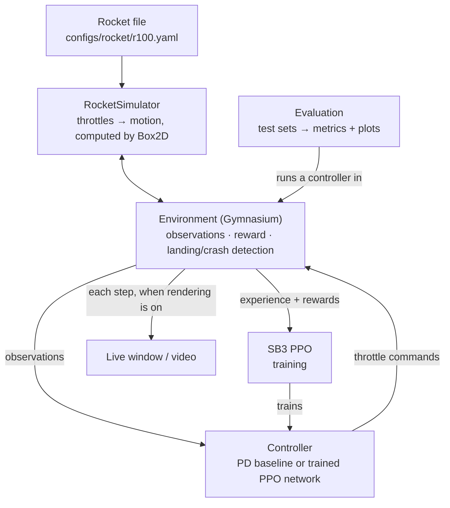

# Implementation Plan

> Companion to [`project.md`](project.md). That document defines *what* and *why*; this one defines *how* and *in what order*.  
> **Status:** Phases 0–1 done, 2026-10-16.

## 1. Decisions

| Topic | Decision |
| --- | --- |
| Vehicle | 100 kg, 3 m rocket (§2), described in `configs/rocket/r100.yaml` |
| Physics | Box2D |
| RL algorithm | PPO from Stable-Baselines3 (SB3) |
| Environment API | Gymnasium |
| Visualization | Live pygame-ce window (on/off switch), video export, Matplotlib plots |
| Tooling | Python 3.13, `uv` (virtual environment in `.venv/`), `pytest`, `ruff`, TensorBoard |

We use Box2D and SB3 as they are. We don't write our own physics engine or PPO, and anything Box2D can calculate (center of mass, inertia, torques, contacts), we let Box2D calculate.

Verified on this machine (Windows 11, Python 3.13): `gymnasium 1.4.0`, `box2d 2.3.10` (prebuilt wheel, no compiler needed), `pygame-ce 2.5.8`, `stable-baselines3 2.9.0`, and `torch 2.14.1` all install; Box2D runs.

## 2. Vehicle specification (V1)

Starting values, checked by tests.

| Property | Value | Notes |
| --- | --- | --- |
| Mass | 100 kg, fixed | 80 kg body + 20 kg engine block filling the bottom 0.4 m |
| Body | 3.0 m tall, 0.3 m wide | A rectangle in 2D |
| Center of mass | 1.24 m above the base | Calculated by Box2D from the shapes |
| Moment of inertia | ≈ 88 kg·m² about the CoM | Calculated by Box2D from the shapes |
| Main nozzle (u₁) | 2000 N max, along the body axis, through the CoM | T/W = 2.04, so up to 10.2 m/s² of net deceleration |
| Side nozzles (u₂, u₃) | 25 N max each, opposing, 2.7 m above the base (1.46 m lever arm) | 24 °/s² of angular acceleration, 0.25 m/s² of direct lateral acceleration |
| Landing legs | Leg tips at ±0.6 m, at base level | Static tip-over angle ≈ 26° |
| Control rate | 50 Hz (20 ms) | Physics split into 5 × 4 ms Box2D steps |

**Why the side nozzles sit high:** placed above the CoM, the lateral force and the torque it creates point the same way. Placed below the CoM, the rocket would have to push away from the target to tilt toward it, a wrong-way response that is much harder to control.

**How it translates:** mostly by tilting. 10° of tilt at hover thrust gives 1.7 m/s² of lateral acceleration, about 7× what the side nozzles give directly.

**Stopping distance at full thrust:** 4.9 m from 10 m/s, 19.6 m from 20 m/s, 44 m from 30 m/s. The starting conditions (§4) must respect this.

**Later (Phase 6):** 70 kg dry + 30 kg propellant at Isp ≈ 250 s gives ≈ 75 s of hover time.

## 3. How the pieces fit



| Piece | What it does | Phase |
| --- | --- | --- |
| Rocket spec (`rocket_spec.py` + YAML) | Rocket shapes, masses, nozzles | 1 ✓ |
| Simulator (`rocket_simulator.py`) | Gives the rocket's shapes to Box2D and applies each nozzle's force where it is mounted; Box2D does the rest | 1 ✓ |
| Environment | Starts episodes, gives observations, computes rewards, detects landing or crash | 2 |
| Live window | Shows flights as they happen; records videos | 3 |
| PD baseline | A hand-written classical controller, for comparison | 4 |
| Evaluation | Runs a controller on fixed test sets and reports metrics | 4 |
| Training | Trains a PPO network with SB3 | 5 |

Design choices:

- **Both controllers are used the same way:** observation in, throttle commands out. The evaluation code and the live window therefore work for the PD baseline and the trained network alike, which makes comparing them easy.
- **Observations are in physical units.** The PPO network scales its own inputs. This matches a real rocket, whose sensors produce physical units.
- **Rendering is an on/off switch.** Gymnasium's `render_mode=None` during training keeps it at full speed; `render_mode="human"` opens a live window paced to real time.
- **Flights are reproducible.** With a fixed seed, frozen weights, and deterministic actions, re-running an episode reproduces the same flight, so any evaluation episode can be re-flown live.

### Environment contract (V1)

| Item | Definition |
| --- | --- |
| Observation | `[x, y, vx, vy, sin θ, cos θ, ω, m]` (8 values). sin/cos avoids the angle wrap-around jump; `m` is constant in V1 but kept for forward compatibility. |
| Action (agent side) | `Box(-1, 1, shape=(3,))`, mapped to throttles `u = (a + 1) / 2 ∈ [0, 1]` inside the env. SB3 expects symmetric, normalized action spaces. |
| Terminated | Safe landing · unsafe touchdown · tilt beyond limit · leaving the flight region |
| Truncated | Time limit (60 s). Reported as *truncated*, not *terminated*, so PPO's value estimates stay correct. |
| Touchdown detector | Box2D reports when a leg touches the ground; the landing is judged on the **pre-contact** state (Box2D's contact solver changes velocities during the contact step). A separate safety supervisor cuts all engines after a confirmed touchdown. |
| Reward v1 | Potential-based shaping `γΦ(s′) − Φ(s)` on distance, speed, and tilt; a small fuel penalty `−c·Σuᵢ·dt`; terminal: large bonus for a safe landing, a penalty that **grows with impact severity** for unsafe touchdowns, a fixed penalty for leaving the region. Coefficients get tuned in Phase 5. |

## 4. Starting conditions (difficulty levels)

| Level | Altitude | x | vx | vy | θ | ω |
| --- | --- | --- | --- | --- | --- | --- |
| 0 (easy) | 50–80 m | ±5 m | ±1 m/s | −5…−10 m/s | ±3° | 0 |
| 1 | 50–150 m | ±20 m | ±5 m/s | −5…−20 m/s | ±10° | ±5°/s |
| 2 | 100–200 m | ±40 m | ±10 m/s | −10…−30 m/s | ±15° | ±10°/s |

Every level has a **fixed held-out test set** (e.g. 500 seeded starting states) that is never used in training. The PD baseline also checks that each level is feasible (Phase 4).

## 5. Phases

Each phase ends with a review and a PR.

### Phase 0: Project skeleton ✓
- `uv` project with `.venv/`, locked dependencies, `ruff`, `pytest`, YAML config loading.

### Phase 1: Rocket and physics ✓
- Rocket file `r100.yaml` and `RocketSpec`: shapes, masses, nozzles.
- `RocketSimulator`: gives Box2D the rocket as two rectangles with densities (Box2D calculates mass, center of mass, and inertia) and applies each nozzle's force at its mounting point (Box2D turns that into pushing and turning). Sleeping disabled, 5 sub-steps per control step.
- Tests comparing Box2D against hand calculations and known physics: mass properties, free fall, hover, torque/inertia, sign conventions.
- `scripts/scripted_flight.py` flies a fixed command sequence and plots it.

### Phase 2: Gymnasium environment
- Ground and leg shapes in Box2D (Box2D detects touchdown), observation and action spaces, random starting states per difficulty level, reward v1, termination/truncation, touchdown detector + safety supervisor, seeding (same seed → same flight).
- **Done when:** Gymnasium's `check_env` passes, 1000 random-action episodes run without errors, and steps/second is measured.

### Phase 3: Live visualization
- **pygame window:** ground, pad, rotating rocket with legs, flames sized by each nozzle's throttle, trajectory trail, and a status overlay (altitude, velocities, tilt, throttle bars, outcome).
- **On/off switch:** Gymnasium's `render_mode` (`None` for training, `"human"` for watching). Paced to real time, with pause, slow motion, and fast-forward.
- **Video export:** `render_mode="rgb_array"` + Gymnasium's `RecordVideo` wrapper, for MP4 demos.
- **Manual flight:** keyboard control (↑ main engine, ←/→ side nozzles), a quick physics check and a fun demo.
- Done before any controller, because watching flights is the fastest way to catch physics and reward bugs.
- **Done when:** you can fly the rocket by hand in the window and export a flight to video.

### Phase 4: PD baseline + evaluation
- **PD controller:** an outer loop turns position and velocity errors into a desired tilt and main throttle; an inner loop holds the tilt using the side nozzles.
- **Evaluation:** runs a controller on a level's test set and reports the metrics in §7 as a table and Matplotlib plots (trajectories, landing dispersion). Any test episode can be re-flown live from its seed.
- **Done when:** baseline metrics exist for every level, and any infeasible starting conditions are removed.

### Phase 5: Train with SB3 PPO
- 8 parallel environments, TensorBoard logging, checkpoints, difficulty levels from 0 upward, reward tuning, at least 3 training seeds.
- **Watching a trained network:** load the saved weights and fly with `deterministic=True` (the network's best action, without PPO's exploration noise).
- **Watch trained networks fly regularly.** Reward hacking is far easier to spot in the live window than in reward curves.
- **Done when:** ≥ 90% safe landings on the level-0 test set (the provisional target from `project.md`), with a side-by-side comparison against the baseline.

### Phase 6: Robustness
- Add, one at a time: aerodynamic drag, wind and gusts, sensor noise, engine lag, minimum main-engine throttle, fuel burn with changing mass, side-nozzle degradation and failure.
- Train with randomized conditions; analyze failure modes; compare with the baseline under each disturbance.
- **Done when:** a robustness report with quantified failure modes exists.

### Phase 7: Deployment readiness
- Export the network to ONNX; measure inference time; command limiting and safety supervisor as a separate layer; written hardware interface spec (observation/action units, rates, limits).
- **Done when:** a deployment architecture document exists. This is not a flight-certified system.

## 6. Repository layout

```
deep-rl-flight-control/
├── pyproject.toml / uv.lock
├── configs/
│   ├── rocket/r100.yaml        # the rocket
│   ├── env/default.yaml        # starting conditions, limits, reward weights (Phase 2)
│   └── train/ppo.yaml          # PPO settings (Phase 5)
├── src/rocketlander/
│   ├── config_loader.py        # YAML → Python objects, with strict checking
│   ├── rocket_spec.py          # RocketSpec: shapes, masses, nozzles
│   ├── rocket_state.py         # RocketState: position, speed, tilt, spin
│   ├── rocket_simulator.py     # RocketSimulator: the rocket in Box2D
│   ├── env/                    # Gymnasium environment, reward, landing detection (Phase 2)
│   ├── viz/                    # live window, video, plots (Phase 3)
│   ├── baseline.py             # PD controller (Phase 4)
│   ├── evaluate.py             # metrics on test sets (Phase 4)
│   └── train.py                # SB3 PPO training (Phase 5)
├── scripts/                    # standalone scripts, e.g. scripted_flight.py
├── tests/
├── runs/                       # outputs and plots (git-ignored)
└── docs/
```

## 7. Evaluation protocol

For every controller, on each level's held-out test set:

- Safe-landing rate (%), plus a breakdown of why the other episodes failed.
- Landing position error; horizontal and vertical touchdown speed; tilt and angular rate at touchdown.
- Fuel used (throttle integral in V1, propellant mass later).
- PPO results reported as mean ± spread across training seeds.

## 8. Known pitfalls

| Pitfall | Mitigation |
| --- | --- |
| Integration error at a 20 ms step (measured: ~10 cm after 1 s of free fall) | 5 Box2D sub-steps per control step; tests bound the error |
| Box2D's 2D densities are mass per area, not per volume | Densities are derived from the masses in the rocket file |
| Box2D computing in 32-bit floats (e.g. ~0.0002 °/s of spurious spin after 2 s at full thrust) | Negligible for control; tests use matching tolerances |
| Box2D putting bodies to sleep, and capping motion at 2 m per step | Sleeping disabled; sub-steps keep per-step motion small |
| Contact solver altering touchdown velocity | Judge touchdown on the pre-contact state |
| Asymmetric action space hurting PPO | Agent sees `[-1, 1]`, env rescales |
| Time limit treated as failure | Use `truncated`, not `terminated` |
| Agent crashing on purpose to stop a per-step penalty | Shaping via potentials; keep per-step penalties small relative to crash penalty |
| Reward hacking | Regular viewing of trained networks in the live window |

## 9. Next step

Phase 2: the Gymnasium environment.
