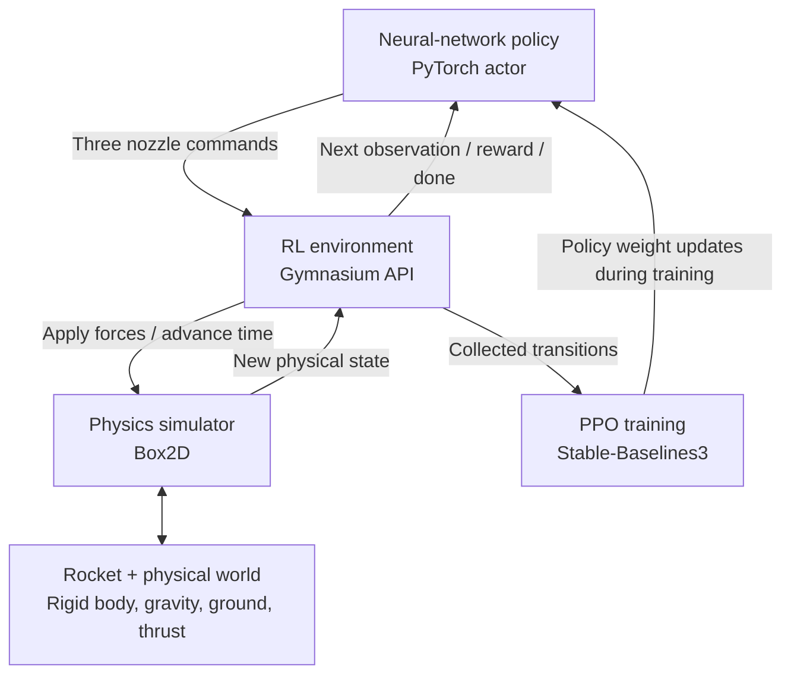

# Autonomous Rocket Landing Using Reinforcement Learning

> **Project status:** Planning / problem definition  
> **Initial scope:** 2D simulated rocket, three independently controlled nozzles, a neural-network flight controller trained with Proximal Policy Optimization (PPO).

## Overview

Build an **AI-powered flight controller that learns to land a rocket autonomously** using a neural network trained with PPO.

The controller will first be trained and evaluated in a simulated physical environment. Our longer-term objective is to design the controller and its software interfaces so that the learned policy could *potentially* be transferred to real hardware, following extensive validation.

The engineering focus is **autonomous control, physics, reinforcement learning, and robustness**—not developing an elaborate graphical interface.

## 1. Problem statement

Consider a rocket descending through the atmosphere toward a landing target at horizontal coordinate \(x = 0\), on ground level \(y = 0\).

The rocket has **three independently controlled nozzles** that generate thrust to influence its position and orientation.

**Problem:** Given the rocket's current position, velocity, orientation, and relevant physical measurements, determine how much thrust each nozzle should produce so that the rocket lands safely at the target.

The controller should:

- Land at the target without excessive horizontal or vertical speed.
- Maintain a stable, near-upright orientation at touchdown.
- Handle different starting positions, velocities, and orientations.
- Learn its control policy through reinforcement learning rather than following a predefined sequence of throttle commands.
- Shut down the nozzles after a confirmed landing via a separate touchdown/safety mechanism.

## 2. What constitutes a successful landing?

Simply reaching \((0,0)\) is insufficient: the rocket could reach the target while moving dangerously fast or rotating uncontrollably.

### Proposed initial success criteria

| Measurement | Initial target |
| --- | ---: |
| Horizontal landing error | ≤ 0.5 m |
| Horizontal touchdown speed | ≤ 0.5 m/s |
| Vertical touchdown speed | ≤ 1.0 m/s |
| Rocket tilt | ≤ 5° |
| Angular velocity | ≤ 5°/s |
| After confirmed touchdown | Engines off |

These are **provisional project targets**, not validated safety specifications. They should be revised after defining the rocket's physical characteristics and acceptable operating envelope.

Fuel consumption is another metric to track, but **safe landing takes priority over fuel efficiency**.

> **Coordinate clarification:** The landing pad is centered at \(x=0\) on the ground \(y=0\). At touchdown, the rocket's center of mass will still be above the ground. The target is not a requirement for the rocket's center of mass to equal \((0,0)\).

## 3. First version: rocket and physical world

Start with a **2D model**, rather than a 3D one, to focus on the control and machine-learning problem before introducing additional complexity.

| Property | Initial design |
| --- | --- |
| World | 2D: horizontal X and vertical Y axes |
| Gravity | 9.81 m/s² downward |
| Ground | Horizontal surface at y = 0 |
| Target | Landing pad centered at x = 0 |
| Rocket | Rigid body with mass and rotational inertia |
| Nozzle 1 | Main propulsion nozzle at the base |
| Nozzles 2 and 3 | Opposing lateral attitude-control thrusters |
| Atmosphere | Begin with no wind or aerodynamic drag; add later |
| Fuel | Begin with fixed mass; model fuel consumption later |

The main nozzle generates thrust along the rocket's longitudinal axis. Lateral nozzles generate forces and torques that can change the rocket's orientation and horizontal motion.

**Important:** The nozzles' locations, thrust directions, maximum forces, and torque effects must be explicitly specified to create a physically consistent and controllable system. Simply having three nozzles does not guarantee that every maneuver is feasible.

### The physical model versus the RL environment

These are distinct components:

- **Rocket:** The modeled physical object—its mass, geometry, inertia, state, and thrusters.
- **Physical world:** Gravity, ground, atmosphere, wind, and other environmental influences.
- **Physics simulator (e.g., Box2D):** Software that numerically computes the rocket's motion and interactions according to physical laws.
- **RL environment (e.g., a Gymnasium-compatible class):** Software that initializes episodes, supplies observations, accepts actions, advances the simulator, calculates rewards, and reports completion or failure.
- **RL agent:** The neural-network controller, trained with PPO, that maps observations to control commands.

## 4. Neural network: observations and actions

The neural network is the **flight controller**. At each control step, it receives the current rocket state and outputs commands for the three nozzles.

### Observations (inputs)

The initial observation vector is:

\[
s_t = [x,\ y,\ v_x,\ v_y,\ \theta,\ \omega,\ m]
\]

| Variable | Physical meaning | Unit |
| --- | --- | --- |
| \(x\) | Horizontal position relative to target | m |
| \(y\) | Altitude | m |
| \(v_x\) | Horizontal velocity | m/s |
| \(v_y\) | Vertical velocity | m/s |
| \(\theta\) | Rocket orientation | rad |
| \(\omega\) | Angular velocity | rad/s |
| \(m\) | Rocket mass | kg |

For V1, assume these values are accurate and immediately available. Later versions will include realistic sensor limitations and state-estimation uncertainty. Input normalization/scaling may be useful during training.

### Actions (outputs)

The neural network outputs three continuous throttle commands:

\[
a_t = [u_1,\ u_2,\ u_3],\qquad u_i \in [0,1]
\]

Where:

- `0` means no thrust.
- `1` means maximum available thrust for that nozzle.
- Intermediate values represent a fraction of the nozzle's available thrust, **assuming the actuator can throttle continuously**.

The physics model translates throttle fractions into forces and torques using each nozzle's maximum thrust, direction, and position. Real actuators may have different capabilities and limits; those must be reflected in later action spaces.

**The network decides what action to take now; it does not simply predict the final landing location.**

## 5. Reinforcement learning objective

Use **PPO (Proximal Policy Optimization)** to train the neural-network policy.

The objective is to maximize expected discounted cumulative reward:

\[
\max_{\theta}\;\mathbb{E}\left[\sum_{t=0}^{T}\gamma^t r_t\right]
\]

Here, \(\theta\) represents the policy's learned parameters, \(r_t\) is the reward at timestep \(t\), and \(\gamma\) is a discount factor.

### Proposed reward design

| Event or behavior | Reward direction |
| --- | --- |
| Safe landing on the pad | Large positive |
| Crash or unsafe touchdown | Large negative |
| Progress toward the landing target | Positive |
| Excessive horizontal or touchdown velocity | Negative |
| Excessive rocket tilt | Negative |
| Unnecessary fuel use | Small negative |
| Excessive hovering time | Small negative |

The exact formula and coefficients are **to be designed and tuned experimentally**. For example, over-rewarding proximity to the pad could cause the agent to crash into it quickly instead of landing safely.

### Episode termination

An episode ends when the rocket:

1. Lands safely.
2. Crashes or touches down outside the allowable limits.
3. Leaves the permitted flight region.
4. Reaches the episode time limit.

Engine shutdown at touchdown should be handled by a dedicated landing detector/safety mechanism rather than depending solely on the NN learning to output zero throttle.

### PPO versus gradient descent

PPO does **not** replace backpropagation or gradient-based optimization. PPO constructs a policy-learning objective from the agent's simulated experiences and rewards; a gradient optimizer (commonly Adam) updates the neural network's weights.

During training, PPO commonly uses an actor (policy) and a critic (value function). During ordinary deployment, the actor policy performs inference without needing the PPO training loop.

## 6. System architecture

A typical control iteration:

1. The environment obtains the rocket's current state from the simulator.
2. The state is provided to the neural-network policy.
3. The policy outputs throttle values for the three nozzles.
4. The environment applies those commands through the physics simulator.
5. The simulator advances the rocket's physical state.
6. The environment calculates reward, landing/crash status, and the next observation.
7. The loop repeats until the episode ends.

For V1, the proposed timestep is **20 ms** (50 simulation/control steps per second). This is an initial design choice, not a validated real-hardware control frequency.

### Simulation versus physical deployment

During **training**, the NN interacts with a virtual rocket and world. PPO updates the policy from simulated experiences.

During **potential physical deployment**, a flight computer could run the trained NN, receive estimated state measurements from real sensors, and send bounded commands through lower-level actuator controllers to real nozzles.

The neural network can be stored and executed **onboard** the rocket; it does not need to be trained onboard. Transferring the same policy to hardware requires matching observation/action semantics, handling actuator limits, and extensive safety and real-time validation.

## 7. Technology choices

| Technology | Responsibility |
| --- | --- |
| Python | Initial development language |
| PyTorch | Neural-network policy |
| Stable-Baselines3 | PPO implementation and training |
| Gymnasium | Custom RL environment interface |
| Box2D | 2D rigid-body physics |
| Matplotlib | Training, trajectory, and evaluation plots |

We will use existing libraries for generic infrastructure, but develop the project-specific rocket dynamics, control interface, reward design, evaluation, and testing.

A graphical UI is **optional**, not a primary deliverable. Basic rendering or plots are sufficient for debugging and communication.

## 8. Implementation roadmap

### Phase 1 — Build and validate the physical model

- Define rocket mass, dimensions, moment of inertia, and center of mass.
- Define nozzle locations, thrust directions, maximum thrust, and torque effects.
- Model gravity, rigid-body motion, ground contacts, and collisions.
- Verify the model against simple known physical expectations.

**Deliverable:** A physically consistent rocket model responding to manually specified nozzle commands.

### Phase 2 — Create the RL environment

- Expose observations and accept three continuous actions.
- Implement episode resets and configurable starting states.
- Add rewards, success/crash detection, and termination conditions.
- Run episodes headlessly (without a UI).

**Deliverable:** An environment that can execute automated flight episodes.

### Phase 3 — Establish a classical controller baseline

- Implement a simple PID/PD-based controller or suitable classical alternative.
- Measure landing success and other metrics.
- Use the baseline to identify simulator errors and establish a point of comparison.

**Deliverable:** Baseline landing-performance measurements.

### Phase 4 — Train with PPO

- Choose a manageable neural-network architecture.
- Train first on simpler scenarios.
- Gradually vary initial altitude, lateral position, velocity, and orientation.
- Tune rewards, PPO hyperparameters, and training conditions.

**Deliverable:** A trained NN policy that lands from varied initial conditions.

### Phase 5 — Evaluate robustness

- Add wind and aerodynamic disturbances.
- Add observation noise and uncertainty.
- Model changing mass, actuator delays, and reduced thrust.
- Investigate individual nozzle degradation or failure.
- Compare against the classical-controller baseline.

**Deliverable:** Quantitative evidence of robustness and identified failure modes.

### Phase 6 — Explore Sim-to-Real readiness

- Separate policy training from inference.
- Define a hardware-compatible observation/action interface.
- Investigate onboard inference latency and real-time requirements.
- Design safety supervision, actuator command limiting, and touchdown detection.
- Consider hardware-in-the-loop testing and state-estimation requirements.

**Deliverable:** A deployment-oriented architecture—not a flight-certified system.

## 9. Evaluation plan

The primary deliverable is **experimental evidence**, rather than visual polish.

Evaluate on previously unseen initial states (for example, **500** test episodes), ideally using multiple random training seeds. Report:

- Safe landing rate (%).
- Landing position error (m).
- Horizontal and vertical touchdown speed (m/s).
- Rocket tilt and angular velocity at touchdown.
- Fuel consumption (once modeled).
- Performance under wind, observation noise, and actuator failures.
- Comparison against a classical control baseline.

A provisional milestone is **90% safe landings** on a clearly defined set of uncomplicated test scenarios. This is a **target**, not an anticipated outcome or evidence of real-world safety.

## 10. V1 scope and exclusions

### Included

- [ ] 2D rigid-body world and gravity.
- [ ] One rocket with three modeled nozzles.
- [ ] Ground and landing pad at x = 0.
- [ ] Accurate position/velocity/orientation observations.
- [ ] Continuous nozzle throttle commands.
- [ ] Landing/crash detection and reward function.
- [ ] PyTorch neural network trained by PPO.
- [ ] Baseline control and quantitative evaluation.

### Deferred

- Realistic aerodynamics and wind.
- Sensor noise and state-estimation errors.
- Fuel depletion and variable mass.
- Engine response delays and other actuator dynamics.
- Three-dimensional movement.
- Physical hardware deployment.
- Elaborate UI or graphics.

## 11. First engineering decision

**Define the rocket's physical characteristics and nozzle configuration before selecting the network architecture or tuning PPO.**

At minimum, determine:

- Rocket mass and dimensions.
- Moment of inertia and center of mass.
- Main nozzle position, direction, and maximum thrust.
- Side nozzle positions, directions, and maximum thrust.
- Permitted throttle ranges and any other actuator constraints.
- Ground-contact geometry and acceptable touchdown conditions.
- Initial training envelope (starting positions, velocities, and orientations).

These choices determine which maneuvers are physically possible and whether the control problem is learnable.

---

**Core engineering principle:** We are not trying to make a rocket look convincing on a screen. We are trying to train, measure, and eventually make deployable a controller that reliably acts on physical dynamics.

### References

- [Gymnasium documentation](https://gymnasium.farama.org/)
- [Stable-Baselines3 documentation](https://stable-baselines3.readthedocs.io/)
- [PyTorch documentation](https://pytorch.org/docs/stable/index.html)
- [Box2D](https://box2d.org/)
